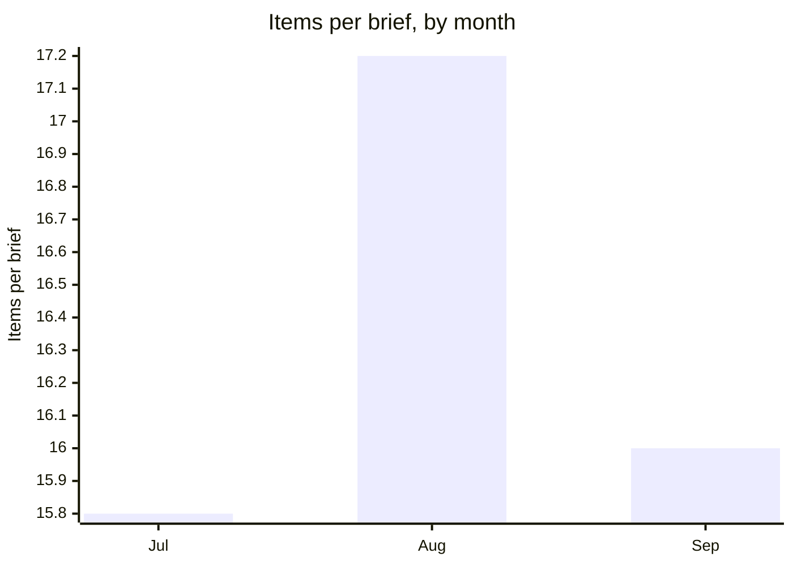

# Intel · Q3 2026

**AU Cyber Brief · Quarterly Threat Intelligence Review** · July – September 2026 · Published 21 October 2026 · `TLP:CLEAR`

Quarterly pattern analysis of the AU Cyber Brief's daily briefs, 16 July – 30 September 2026: 56 briefs and 917 items.
Briefs say what happened; this report says what the pattern is. Every claim cites the brief dates it rests on, and
every count comes from code (see Method).

> [!IMPORTANT]
> **Bottom line:** Internet-facing appliances were the quarter's front door, and Qilin walked through it more each
> month. Patching edge devices remains the single highest-leverage control for Australian organisations going into Q4.

## Summary

- **Edge appliances and enterprise servers were the main way in.** Cisco, SonicWall and N-able products were
  exploited week after week, and ransomware crews used those flaws as their entry point.
- **Qilin was the constant in ransomware**, on 37 days, and it got busier each month. Around it, The Gentlemen and a
  long tail of new brands kept appearing.
- **Extortion crews became the story themselves.** ShinyHunters and Cl0p ran the quarter's biggest data-theft
  campaigns, then turned on each other in late September.
- **Nation-state activity was steady and predictable.** China's Salt Typhoon was named on 29 days and Lazarus on 21.
- **Australia's exposure was mostly through third parties** and a grind of mid-sized victims. 257 items were
  Australian.

<!-- at-a-glance:start (generated by intel.figures from the stats; do not edit) -->
## At a glance

| **56** | **917** | **257** | **195** | **34** |
| :---: | :---: | :---: | :---: | :---: |
| daily briefs analysed | items reported | Australian items | exploited-in-the-wild items | ransomware & extortion groups named |

**Ransomware & extortion groups** (named on how many briefs)

| | Name | Days | Share of briefs |
| ---: | --- | ---: | --- |
| 1 | Qilin | 37 | `███████░░░` 66% |
| 2 | ShinyHunters | 23 | `████░░░░░░` 41% |
| 3 | Cl0p | 17 | `███░░░░░░░` 30% |
| 4 | The Gentlemen | 17 | `███░░░░░░░` 30% |
| 5 | Akira | 14 | `██░░░░░░░░` 25% |
| 6 | Scattered Spider | 13 | `██░░░░░░░░` 23% |

**Nation-state actors** (named on how many briefs)

| | Name | Days | Share of briefs |
| ---: | --- | ---: | --- |
| 1 | Salt Typhoon | 29 | `█████░░░░░` 52% |
| 2 | Lazarus | 21 | `████░░░░░░` 38% |
| 3 | APT29 | 5 | `█░░░░░░░░░` 9% |
| 4 | Mustang Panda | 4 | `█░░░░░░░░░` 7% |
| 5 | Sandworm | 4 | `█░░░░░░░░░` 7% |
| 6 | APT28 | 2 | `░░░░░░░░░░` 4% |

**Most-named vendors** (named on how many briefs)

| | Name | Days | Share of briefs |
| ---: | --- | ---: | --- |
| 1 | Microsoft | 37 | `███████░░░` 66% |
| 2 | Windows | 21 | `████░░░░░░` 38% |
| 3 | Cisco | 19 | `███░░░░░░░` 34% |
| 4 | SonicWall | 18 | `███░░░░░░░` 32% |
| 5 | SharePoint | 16 | `███░░░░░░░` 29% |
| 6 | N-able | 14 | `██░░░░░░░░` 25% |

**Most-targeted sectors** (named on how many briefs)

| | Name | Days | Share of briefs |
| ---: | --- | ---: | --- |
| 1 | Finance | 42 | `████████░░` 75% |
| 2 | Health | 37 | `███████░░░` 66% |
| 3 | Government | 30 | `█████░░░░░` 54% |
| 4 | Telecommunications | 30 | `█████░░░░░` 54% |
| 5 | Energy & utilities | 22 | `████░░░░░░` 39% |
| 6 | Technology | 17 | `███░░░░░░░` 30% |

<!-- at-a-glance:end -->

## Recurring themes

- **Internet-facing appliances and servers, exploited repeatedly.** Cisco was named on 19 days (17 Jul – 24 Sep),
  SonicWall on 18 (20 Jul – 25 Sep), N-able on 14 (4 Aug – 10 Sep) and NetScaler on 12 (21 Aug – 30 Sep). SonicWall
  SMA1000 zero-days were exploited from 20 Jul to 31 Jul, and Akira returned to SonicWall devices on 25 Sep. Cisco
  Firewall Management Center was hit by a zero-day on 30 Jul.
- **Ransomware arriving through those flaws.** Qilin was deployed after a Palo Alto GlobalProtect bypass
  (CVE-2026-0257) was exploited (24 Jul, 27 Jul), and Akira followed the SonicWall flaws (25 Sep). Patching
  internet-facing appliances was the single highest-leverage control of the quarter.
- **Qilin on top.** Qilin was named on 37 of 56 briefs (16 Jul – 29 Sep), and briefs called it 2026's dominant
  ransomware brand (22 Jul).
- **New ransomware brands every few weeks.** The Gentlemen (17 days; 483 claimed victims and a 90% affiliate cut on
  16 Jul and 20 Jul), Gunra (11 days, 4 Aug – 3 Sep), INC Ransom (8 days) and Lynx (7 days) all sat behind Qilin.
  Researchers described a new brand emerging roughly weekly as takedowns fragmented crews (23 Jul).
- **Mass data theft by a few named crews.** Cl0p (17 days) ran two campaigns: PTC Windchill/FlexPLM (CVE-2026-12569,
  28 Jul – 10 Aug), then Oracle E-Business Suite (7 Sep, 9 Sep), with about 100 companies hit per Mandiant (7 Sep).
  ShinyHunters (23 days) claimed EY (28 Jul – 3 Aug), Metabase (13 Aug) and Logitech (21 Aug), and attempted
  ReliaQuest without success (25 Aug).
- **AI as both a weapon and a target.** The first documented AI-agent ransomware campaign, JadePuffer, appeared on
  17 Jul and 22 Jul, and Gemini CLI was abused as a hacking agent (18 Jul). AI platforms were exploited too: a
  ServiceNow AI flaw within days of disclosure (24 Jul). The AFP warned of AI-driven investment scams against
  Australians (24 Jul, 27 Jul).
- **The most targeted sectors were finance (42 days), health (37 days), government (30 days) and telecom (30 days).**
  Telecom was mostly Salt Typhoon (16 Jul – 29 Sep).

## Trends

There is no archive before 16 Jul, so trends compare the three months within the quarter. July has only 13 briefs
against 21 in August and 22 in September, so compare days within each month.

- **Qilin rose each month:** 9 days in July, 12 in August, 16 in September (16 Jul, 22 Jul, 29 Sep).
- **Salt Typhoon intensified:** 6, then 8, then 15 days. September brought a Five Eyes-plus joint advisory naming it
  (2 Sep, 7 Sep, 8 Sep).
- **Lazarus peaked in August:** 2, then 11, then 8 days. The August peak was South Korean warnings that Lazarus was
  sharing tooling with ransomware crews (3 Aug, 4 Aug, 11 Aug).
- **ShinyHunters escalated:** 4, then 8, then 11 days. It ended the quarter with a claimed FBI breach through an
  Oracle PeopleSoft zero-day (23 Sep, 24 Sep).
- **The Gentlemen surged late:** 4 days in July and 2 in August, then 11 in September (2 Sep – 9 Sep).
- **Patch volume kept rising.** Microsoft's monthly fixes went from about 570 (16 Jul) to 421 (1 Sep), then a
  record of about 966 (9 Sep, 10 Sep). Microsoft was named on 37 days.

## Timing

- Coverage was even across the working week: 11 briefs on each weekday and one Saturday brief.
- Monday carried the most items (188), as weekend news landed, and Friday the fewest (170). Australian items were
  most common on Thursdays (56) and least common on Fridays (46).
- Patch Tuesday clusters were visible in the briefs a day or two later each month (16 Jul, 1 Sep, 9 Sep).

## Carry-overs

Named threats that recurred across most of the quarter without resolution:

- **Qilin:** 37 days, 16 Jul – 29 Sep.
- **Salt Typhoon:** 29 days, 16 Jul – 29 Sep. The joint advisories repeat, but the campaign continues.
- **ShinyHunters:** 23 days, 17 Jul – 30 Sep.
- **Lazarus:** 21 days, 17 Jul – 25 Sep.
- **SonicWall:** 18 days, 20 Jul – 25 Sep. Its flaws were exploited again two months after the July zero-days.
- **Scattered Spider:** 13 days, 16 Jul – 24 Sep, still deploying RansomHub and Qilin payloads (16 Jul, 21 Jul).

## Anomalies

- **Criminal-on-criminal extortion.** ShinyHunters broke into and defaced Cl0p's leak site and threatened to extort
  the extortionists (21 Sep, 22 Sep, 23 Sep). This is a single episode so far, so a thin pattern.
- **Physical-impact state activity.** Iran's IRGC was suspected in a four-day shutdown of a UK power plant (27 Aug).
  Iran appeared on only 8 days, so this is thin, but it's the quarter's clearest physical-impact precedent.
- **A failed intrusion made public.** ReliaQuest disclosed a ShinyHunters social-engineering attempt that didn't get
  data out (25 Aug). This is a single item, so thin.
- **A ransomware claim against an Australian health department was publicly denied.** MedusaLocker's claim against
  NSW Health was rejected the same day (4 Sep). This is a single item, so thin.

## Watch list for Q4

- Whether the ShinyHunters–Cl0p conflict becomes a pattern of crews targeting each other.
- Cl0p's Oracle E-Business Suite victim list, given how widely Oracle EBS is used across ANZ.
- Akira and other crews on SonicWall and other edge appliances after September's surge.
- AI-agent attacks moving from first cases to volume.
- Australia's draft 72-hour breach-reporting rule under the Privacy Act overhaul, and the first disclosures under it.

## Method

- **Data:** the public-tier items of every daily brief from 16 Jul to 30 Sep 2026: 56 briefs and 917 items. The
  archive begins on 16 Jul, so 1–15 Jul isn't covered.
- **Counting:** counts are distinct brief days. "Named on 9 days" means the name appeared in at least one item in 9
  different briefs, so a story repeated within one brief counts once. Items were tagged by code (sections, keywords and
  curated name lists), and the counts were computed from those tags, not estimated.
- **Thin patterns:** fewer than three occurrences are labelled as thin.
- **Sources:** the dated daily briefs hold the original source links for every item cited here.
